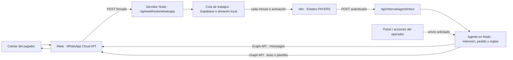

# Integración de WhatsApp Cloud API

> Guía de la integración de demostración de PAYERS. Los identificadores y credenciales se representan con marcadores; no pegues secretos en este documento.

## Tabla de contenido

1. [Resumen](#1-resumen)
2. [Arquitectura](#2-arquitectura)
3. [Variables de entorno](#3-variables-de-entorno)
4. [Flujo del webhook](#4-flujo-del-webhook)
5. [Rol de n8n](#5-rol-de-n8n)
6. [Comandos e intenciones](#6-comandos-e-intenciones)
7. [Reglas de mensajería](#7-reglas-de-mensajería)
8. [Seguridad](#8-seguridad)
9. [Configuración de la demo](#9-configuración-de-la-demo)
10. [Suscripción crítica de la WABA](#10-suscripción-crítica-de-la-waba)
11. [Solución de problemas](#11-solución-de-problemas)
12. [Operación diaria](#12-operación-diaria)
13. [Limitaciones conocidas](#13-limitaciones-conocidas)

## 1. Resumen

La aplicación recibe eventos de WhatsApp Cloud API en el servidor Node, guarda los mensajes elegibles en una bandeja de entrada y ejecuta el agente para responder por WhatsApp. En el modo documentado para esta demo, n8n despierta el procesamiento de la bandeja y evalúa alertas; la lógica del agente y las llamadas a Meta siguen en el servidor.

El agente atiende en **modo abierto** por defecto (`WA_ALLOWED_PHONES` vacía): responde a cualquier número, con el menú existente si tiene reservas o con un aviso de cobranza y el botón **Hablar con alguien** si no las tiene. No negocia ni ofrece disponibilidad: gestiona cobranza de reservas ya registradas y, si `WA_RESERVATION_MODE` está habilitado, registra un pedido ya acordado a partir del mensaje estructurado `RESERVA`. Un pedido de reserva en texto libre se deriva al personal. Las bajas y las consultas sin reserva se persisten y se ven en el panel.

| Pieza | Papel |
|---|---|
| Meta / WhatsApp Cloud API | Entrega los mensajes y estados al webhook y recibe los mensajes salientes. |
| Servidor Node | Verifica el webhook, filtra y encola eventos, procesa mensajes, aplica reglas del pedido y envía respuestas. (`server/api.mjs`: `route`, `incoming`, `processInbox`; `server/providers.mjs`: `sendWhatsApp`.) |
| n8n | Dispara el procesamiento cada minuto o por webhook y solicita las rutas internas del servidor. No implementa por sí mismo la lógica conversacional. (`n8n/Establo-PAYERS.json`; `server/api.mjs`: `drainInbox`, `processInbox`.) |
| Supabase | Persiste pedidos, trabajos de la cola, configuración, bajas/altas y consultas sin reserva cuando se proporcionan las credenciales de servidor. Si no se configura Supabase, el servidor puede usar almacenamiento PostgreSQL local. (`README.md`; `server/config.mjs`: `readConfig`; `supabase/migrations/003_contactos.sql`.) |
| Túnel HTTPS | Expone temporalmente el servidor local para que Meta y n8n puedan alcanzarlo. La guía usa Cloudflare Tunnel; la dirección temporal puede cambiar. (`n8n/Activacion.md`.) |

## 2. Arquitectura

El agente procesa y responde dentro del servidor. n8n es el disparador/orquestador externo; no recibe el contenido del mensaje como resultado del nodo de procesamiento, que devuelve conteos (`n8n/Establo-PAYERS.json`, nodo **Procesar mensajes y adjuntos**).



La cola está en Supabase cuando el almacén remoto está configurado; el backend local es una alternativa de desarrollo, no una dependencia de n8n. (`server/store.mjs`: `openStore`; `server/api.mjs`: manejador de `/api/webhooks/whatsapp`.)

## 3. Variables de entorno

La obligatoriedad de las variables se determina en `server/config.mjs`, función `readConfig`; los nombres y comentarios también aparecen en `.env.example`. “Obligatoria” se refiere al modo WhatsApp Cloud y a la configuración indicada, no a una instalación local con WhatsApp desactivado.

| Nombre | Obligatoria u opcional | Para qué sirve | Dónde se obtiene / define |
|---|---|---|---|
| `WHATSAPP_MODE` | Opcional para arrancar; debe ser `cloud` para habilitar esta integración. | Activa o desactiva el canal. | Se define en el entorno del servidor. |
| `WA_GRAPH_VERSION` | Obligatoria con `WHATSAPP_MODE=cloud`. | Versión de Graph API usada para enviar y descargar medios. | Panel/desarrolladores de Meta; versión exacta disponible para cada cuenta: **no verificado**. |
| `WA_PHONE_NUMBER_ID` | Obligatoria con `WHATSAPP_MODE=cloud`. | Identifica el número de WhatsApp en llamadas de Graph y filtra eventos entrantes. | Configuración/API de WhatsApp de la app en Meta. No copiar el ID a este documento. |
| `WA_ACCESS_TOKEN` | Obligatoria con `WHATSAPP_MODE=cloud`. | Autoriza llamadas de servidor para mensajes y medios. | Credenciales de la app de Meta; el token temporal de la demo vence. |
| `WA_VERIFY_TOKEN` | Obligatoria con `WHATSAPP_MODE=cloud`. | Secreto elegido por el operador, compartido entre el servidor y la configuración del callback para la verificación GET. | Lo genera el operador; no es un token que se lea de Meta. |
| `WA_APP_SECRET` | Obligatoria con `WHATSAPP_MODE=cloud`. | Se usa para verificar la firma HMAC de los POST de Meta. | Configuración de la app de Meta (secreto de la app). |
| `WA_ALLOWED_PHONES` | Opcional. Vacía o ausente activa el **modo abierto**: el agente atiende a cualquier remitente. Con valores, funciona como restricción opcional para demos controladas. | Lista separada por comas de remitentes permitidos, en dígitos y con código de país. Se normaliza a solo dígitos al cargarla. | La define el operador; los destinatarios de prueba también se habilitan en Meta. Usa valores ficticios al documentar, por ejemplo `51XXXXXXXXX`. |
| `WA_BLOCKED_PHONES` | Opcional. | Lista separada por comas de números que se ignoran por completo, con el mismo formato que `WA_ALLOWED_PHONES`. El bloqueo tiene prioridad sobre el modo abierto. | La define el operador. Usa valores ficticios al documentar. |
| `WA_RESERVATION_MODE` | Opcional; predeterminado `off`. | Habilita el alta por mensaje estructurado: `off` no la permite, `staff` solo para los números de `WA_RESERVATION_STAFF` y `open` para cualquier remitente permitido. | Se define en el entorno del servidor. Para una demo controlada usa `staff`. |
| `WA_RESERVATION_STAFF` | Opcional; solo se usa con `WA_RESERVATION_MODE=staff`. | Lista separada por comas de números autorizados a dar de alta reservas, en dígitos y con código de país. | La define el operador; usa valores ficticios al documentar. |
| `WA_RATE_LIMIT_MAX` | Opcional; predeterminado `20`. | Máximo de mensajes entrantes por número dentro de la ventana deslizante. Al superarlo se ignora el mensaje y se envía un solo aviso por ventana. | Se define en el entorno del servidor (entero mayor que 0). |
| `WA_RATE_LIMIT_WINDOW_MS` | Opcional; predeterminado `600000` (10 minutos). | Duración de la ventana deslizante del límite de tasa, en milisegundos. | Se define en el entorno del servidor (mínimo 1000). |
| `WA_TEMPLATE_DEPOSIT` | Opcional. | Nombre de la plantilla aprobada para iniciar un mensaje de anticipo. | Nombre de la plantilla aprobada en WhatsApp Manager. |
| `WA_TEMPLATE_PAYMENT_REJECTED` | Opcional. | Nombre de la plantilla aprobada para avisar un rechazo y permitir reintentar el anticipo fuera de la ventana de 24 horas. | Plantilla con pagador, referencia e importe, más botón URL dinámico hacia el pago. |
| `WA_TEMPLATE_VISIT` | Opcional. | Nombre de la plantilla aprobada para recordatorio de visita. | Nombre de la plantilla aprobada en WhatsApp Manager. |
| `WA_TEMPLATE_CONFIRMATION` | Opcional. | Nombre de la plantilla aprobada para confirmación del anticipo. | Nombre de la plantilla aprobada en WhatsApp Manager. |
| `WA_TEMPLATE_SETTLEMENT` | Opcional. | Nombre de la plantilla de liquidación/constancia final. | Nombre de la plantilla aprobada en WhatsApp Manager. |
| `WA_TEMPLATE_LANGUAGE` | Opcional. | Código de idioma que se envía al pedir una plantilla; el código predeterminado está en `.env.example`. | Debe corresponder al idioma aprobado para la plantilla en WhatsApp Manager. |
| `PUBLIC_URL` | Obligatoria si WhatsApp Cloud está activo. | Origen HTTPS público del servidor, sin ruta; se usa para enlaces y para que el servidor escuche públicamente. | URL del alojamiento o del túnel actual. |
| `AGENT_ORCHESTRATION` | Opcional; predeterminado `server`. | El modo `n8n` delega a n8n el disparo de bandeja y alertas. | Se define en el entorno del servidor. |
| `N8N_AGENT_TOKEN` | Obligatoria si `AGENT_ORCHESTRATION=n8n`. | Autentica las llamadas de n8n a las rutas internas; el servidor exige al menos 32 caracteres. | Se genera como secreto aleatorio y se configura en el servidor y la credencial Header Auth de n8n. |
| `N8N_WAKE_URL` | Opcional; si se configura debe ser HTTPS. | URL Production del webhook de n8n que puede despertar el workflow cuando entra una cola nueva. | Nodo **Despertar por WhatsApp** de n8n. |

Los nombres `WA_TEMPLATE_*` deben corresponder a plantillas aprobadas y a los parámetros que construye el servidor. Tener configurado un nombre no demuestra que Meta haya aprobado esa plantilla; la aprobación debe verificarse en Meta.

Los avisos automáticos se agrupan por teléfono: si hay varios anticipos pendientes, durante una ventana activa se envía una sola lista de selección; fuera de la ventana, se envía como máximo un recordatorio de anticipo aprobado por ciclo. Al pedir el pago manualmente o responder al agente, se genera un único botón de pago. Si el pago es rechazado, el agente ofrece reintentar durante la ventana; fuera de ella requiere `WA_TEMPLATE_PAYMENT_REJECTED`.

## 4. Flujo del webhook

1. **Verificación GET.** Meta llama `GET /api/webhooks/whatsapp` con `hub.mode`, `hub.verify_token` y `hub.challenge`. El servidor exige `hub.mode=subscribe` y compara el token recibido con `WA_VERIFY_TOKEN`; si coincide, devuelve el challenge como texto. (`server/api.mjs`: `route`, rama GET de `/api/webhooks/whatsapp`.)
2. **Recepción POST y firma.** El servidor lee el cuerpo sin alterar y valida `x-hub-signature-256` contra el HMAC-SHA256 del cuerpo calculado con `WA_APP_SECRET`. Si la firma no coincide, devuelve 403. (`server/api.mjs`: `route`; `server/providers.mjs`: `hmac`, `matches`.)
3. **Filtro de número de empresa.** Solo procesa los cambios cuyo `metadata.phone_number_id` coincide exactamente con `WA_PHONE_NUMBER_ID`. (`server/api.mjs`: `route`, rama POST del webhook.)
4. **Filtro de remitentes y enqueue.** En el webhook se descartan los números de `WA_BLOCKED_PHONES` y los que no pasan `WA_ALLOWED_PHONES`. Con `WA_ALLOWED_PHONES` vacía no hay filtro por lista (modo abierto). Solo se encolan mensajes con `id`. (`server/config.mjs`: `readConfig`, `isPhoneAllowed`, `isPhoneBlocked`; `server/api.mjs`: `route`.)
5. **Procesamiento del trabajo.** En `incoming`, el agente normaliza el teléfono a dígitos y descarta mensajes sin ID, bloqueados o no permitidos, con timestamp no numérico, más antiguos de 24 horas o más de 60 segundos en el futuro. También ignora IDs ya vistos en la cola y en memoria. (`server/api.mjs`: `incoming`, `seenMessages`.)
6. **Baja, alta y límite de tasa antes de clasificar.** El texto se normaliza (minúsculas y sin tildes) y se evalúa en este orden: **stop**, **baja**, **darme de baja** o **no quiero mensajes** persisten la baja; **alta** la revierte. Después se aplica el límite por número (`WA_RATE_LIMIT_MAX` por `WA_RATE_LIMIT_WINDOW_MS`): al superarlo no se llama a OpenAI ni a Graph y se envía un único aviso por ventana. (`server/api.mjs`: `incoming`, `rateCheck`, `commandText`; `server/store.mjs`: `setOptOut`.)
7. **Alta estructurada, reservas del teléfono, referencias y número sin reserva.** Antes de buscar reservas del teléfono, si `WA_RESERVATION_MODE` lo permite y el texto empieza con `RESERVA`, el agente valida el mensaje y crea el pedido; el detalle está en [Alta por mensaje estructurado](#alta-por-mensaje-estructurado). Después, el agente busca pedidos del teléfono sin exigir consentimiento para responder. Si el teléfono no tiene reservas, o si el texto menciona una referencia `EST-XXXXXXXX` ajena, responde como número sin reserva: mensaje fijo de cobranza y botón **Hablar con alguien**, sin revelar datos. Si tiene reservas propias y recibe un botón con referencia ajena, esa referencia se ignora y se muestran sus propias reservas. (`server/api.mjs`: `incoming`, `registerReservation`, `replyWithoutReservation`; `server/interactive.mjs`: `noReservationMessage`.)
8. **Pedido de reserva y `staff`.** Un pedido de reserva se deriva al personal: con reserva existente abre la incidencia **Ayuda del personal** y responde el texto fijo de alcance; sin reserva recibe el aviso de número sin reserva. El botón `staff` (sin referencia) crea o incrementa una consulta sin reserva y responde la confirmación, sin chocar con `accion:REF`. (`server/interactive.mjs`: `reservationRequest`, `parseAction`, `reservationHelpMessage`; `server/api.mjs`: `incoming`, `replyWithoutReservation`.)
9. **Referencia `EST-XXXXXXXX` e identificadores interactivos.** Si el texto contiene una referencia válida del teléfono, el agente selecciona esa reserva. Sin referencia, elige pedidos activos del teléfono (o, si no hay, los restantes); si hay varias reservas, envía una lista `sel:REF` para elegir. Los `button_reply` y `list_reply` se leen por `id`; la referencia del id se resuelve solo entre las reservas de ese teléfono. (`server/api.mjs`: `incoming`; `server/interactive.mjs`: `parseAction`.)
10. **Cola y n8n.** El POST válido se guarda en el almacén. En modo `n8n`, el workflow llama `POST /api/internal/agent/inbox`; el servidor exige `Authorization: Bearer <N8N_AGENT_TOKEN>`, procesa hasta dos trabajos por ejecución y devuelve contadores `processed` y `failed`. (`server/api.mjs`: `route`, `processInbox`, `drainInbox`; `server/store.mjs`: `openStore`.)

Los eventos de estado (`sent`, `delivered`, `read`, `failed`) también se encolan y actualizan el estado del mensaje asociado. Una cola vacía puede producir `processed: 0, failed: 0`; es un resultado, no necesariamente un error. (`server/api.mjs`: manejador POST, `delivery`, `processInbox`.)

## 5. Rol de n8n

El workflow importable es **El Establo PAYERS · WhatsApp y alertas** (`n8n/Establo-PAYERS.json`).

- **Cada minuto** ejecuta el workflow programado. **Ejecutar prueba manual** también permite probarlo.
- **Despertar por WhatsApp** es un webhook POST de n8n con autenticación Header Auth. Si `N8N_WAKE_URL` está configurado, el servidor intenta llamar esa URL cuando encola trabajos; el workflow vuelve a consultar la API.
- **API del restaurante** contiene la URL de origen del servidor; hay que reemplazar el marcador del JSON importado.
- **Procesar mensajes y adjuntos** llama a `POST /api/internal/agent/inbox`.
- **Solo horario o prueba manual** deja pasar al nodo de alertas solo el disparador programado o la prueba manual. **Evaluar alertas configuradas** llama a `POST /api/internal/agent/alerts`.

Configura una credencial **Header Auth** con encabezado `Authorization` y valor `Bearer <N8N_AGENT_TOKEN>`. Selecciónala en los nodos que llaman al servidor y en **Despertar por WhatsApp**. La ruta interna valida ese bearer y exige `AGENT_ORCHESTRATION=n8n`. (`n8n/Activacion.md`; `server/api.mjs`: `route`, rutas `/api/internal/agent/*`.)

El workflow incluido no está activo al importarse (`active: false` en el JSON): publícalo/actívalo en n8n para el horario. La URL Production del nodo de despertar es opcional; si no se configura, la revisión por minuto sigue siendo el mecanismo periódico. (`n8n/Establo-PAYERS.json`; `n8n/Activacion.md`.)

## 6. Comandos e intenciones

El clasificador local de `server/intents.mjs` incluye atajos y ejemplos en español. Si se configura `OPENAI_API_KEY`, `server/agent-ai.mjs`, función `classify`, puede clasificar mensajes más largos; ante un error de esa clasificación vuelve al clasificador local. Las respuestas y acciones concretas están en `server/api.mjs`, función `replyTo`.

| Intención / ejemplos | Comportamiento |
|---|---|
| **Menú**, **hola**, **buenas**, **buenos días**, **buenas tardes**, **buenas noches**, **inicio**, **ayuda** | Muestra el menú de la reserva con botones. Con dos o más reservas activas del mismo teléfono, envía una lista agrupada por estado para elegir; con una sola activa va directo a su menú y, si solo hay finalizadas, abre la más reciente. **Ayuda** ya no abre una incidencia: para pedir personal usa **Hablar con alguien** o “quiero hablar con alguien”. |
| **Anticipo**, **enlace**, “quiero pagar”, botón **Pagar anticipo** | Si la reserva sigue pendiente y el plazo está vigente, crea o reutiliza el intento y responde con un mensaje `cta_url` cuyo botón dice **Pagar {importe}**. Después, si Yape o Plin de demostración están activos, envía un segundo mensaje con botones para esos medios. |
| **Yape**, **Plin**, botones **Pagar con Yape** o **Pagar con Plin** | Crean o reutilizan el enlace de ese medio de demostración y responden con un `cta_url`. Los métodos pueden desactivarse en la configuración del agente. No representan una transferencia real. |
| **Saldo**, botón **Ver saldo** | Responde el resumen del pedido, su estado, fecha de visita y saldo pendiente. |
| **Ya pagué**, “te envié el comprobante” | Registra un aviso/incidencia para revisión; no marca automáticamente el pago como confirmado. La confirmación depende del flujo de pago verificado. |
| **Reprogramar**, **cancelar**, **devolución**, **error de pago**, botón **Cambiar fecha** o **Hablar con alguien** | Registra una incidencia y responde que el personal revisará el caso. No realiza por chat la cancelación, devolución ni reprogramación. |
| **Constancia**, **comprobante**, botón **Ver constancia** | Responde con un `cta_url` **Ver constancia** si existe un comprobante; si aún no existe, indica que se habilitará al verificar el pago. |
| **Visita**, **asistencia** | Devuelve el resumen. Una afirmación de asistencia puede registrar una intención, pero la llegada se registra en recepción. |
| **Stop**, **baja**, **darme de baja**, **no quiero mensajes** | Se evalúan antes de clasificar. Persisten la baja del número y responden `Listo, no te enviaremos más recordatorios. Si quieres volver a recibirlos, escribe «alta».` No hay más respuesta a ese mensaje. |
| **Alta** | Revierte la baja y responde `Listo, volverás a recibir los recordatorios de tus reservas.` |
| Número sin reserva: **hola**, **ayuda** u otra consulta | Responde el aviso fijo de cobranza y el botón **Hablar con alguien**. No revela datos de reservas ajenas y no crea una consulta salvo que pida personal. Repite el aviso como máximo una vez cada 12 horas. |
| Botón **Hablar con alguien** (`staff`) o intención **human** desde un número sin reserva | Crea o incrementa una consulta sin reserva visible en el panel y responde `Listo, avisé al personal. Te contactarán pronto.` |
| Pedido de reserva en texto libre (**reservar**, **reserva nueva**, **disponibilidad**, **mesa para**, etc.) | El agente no negocia ni ofrece disponibilidad. Con una reserva existente abre la incidencia **Ayuda del personal** y responde `Por aquí solo gestiono los pagos de tu reserva. Para cambios o una reserva nueva, el personal te ayudará.` con el botón **Hablar con alguien**. Sin reserva, recibe el aviso de número sin reserva. |
| Mensaje estructurado **RESERVA** | Si `WA_RESERVATION_MODE` es `staff` u `open` y el remitente está autorizado, valida los campos, crea el pedido y responde con el total, el anticipo, el vencimiento y el botón **Pagar {importe}**. No usa IA y no acepta importes escritos en el mensaje. |
| Otra consulta | Muestra el menú de la reserva en lugar de pedir comandos de texto. |

Las reglas de `classify` son intencionalmente limitadas; no se garantiza que cualquier paráfrasis se clasifique como se espera. Los comandos de texto anteriores siguen funcionando como respaldo.

Los números sin reserva se guardan en **Conexiones → Consultas sin reserva**: teléfono, fecha, estado abierta/atendida, número de mensajes y hasta 200 caracteres del último texto. Solo hay una consulta abierta por número; los mensajes siguientes incrementan el conteo. El botón **Marcar atendida** la cierra. La consulta se crea únicamente con la acción `staff` o la intención `human`; un **hola** o **ayuda** de un desconocido solo muestra el aviso. (`server/store.mjs`: `noteQuery`, `handleQuery`; `server/api.mjs`: `GET /api/agent/queries`, `POST /api/agent/queries/:id/handled`; `src/AgentSettings.jsx`.)

### Alta por mensaje estructurado

Con `WA_RESERVATION_MODE=staff` u `open`, un mensaje que empieza con la palabra `RESERVA` registra un pedido ya acordado. Es el mismo alta del formulario del panel: el pedido nace en `awaiting_deposit`, con el plazo del anticipo y la cola de alertas activa, y la respuesta incluye el enlace de pago. El bot no negocia disponibilidad ni modifica precios; solo registra lo que el mensaje declara.

```text
RESERVA
Nombre: Ana Cárdenas
Telefono: 51999999999
Fecha: 2026-11-14
Hora: 20:00
Personas: 4
Items: 2x Parrilla familiar, 1x Parrilla personal, 1x Jarra de chicha morada
Notas: Cumpleaños de 40
Consentimiento: si
```

- **Campos obligatorios:** `Nombre`, `Fecha` (`AAAA-MM-DD`), `Hora` (`HH:MM` de Lima), `Personas` (entero de 1 a 40) e `Items`. La visita debe ser futura y con al menos 2 horas de anticipo.
- **Productos:** catálogo fijo de 12 productos (`shared/samples.mjs`), formato `2x Producto`, cantidades de 1 a 100 y hasta 30 líneas. El precio sale siempre del catálogo; un importe escrito en el mensaje no se acepta.
- **Tolerancia:** mayúsculas, tildes, espacios sobrantes y `:` opcional. No se toleran productos inexistentes, fechas ilegibles ni campos ambiguos.
- **Consentimiento:** si el mensaje no trae `Telefono` o coincide con el remitente, el pagador es quien escribe y el consentimiento es implícito. Si trae el teléfono de un tercero, es un alta de operador: el pedido se crea con `consent: true` solo con `Consentimiento: si`; sin esa marca queda `consent: false` y el bot no inicia mensajes hacia el tercero. La respuesta con el enlace vuelve al operador.
- **Duplicados y límites:** la clave teléfono + fecha + personas + productos evita duplicar un reenvío dentro de 10 minutos; se responde `Ya tengo esta reserva registrada: {ref}.`. Cada número admite hasta 3 pedidos abiertos en 30 días, además del límite de tasa.
- **Errores:** un mensaje incompleto no registra nada. El bot responde el campo que falta o el dato inválido y deja una consulta abierta en **Conexiones → Consultas sin reserva**.
- **Origen:** el pedido guarda los eventos `Pedido recibido por WhatsApp` y `Origen: cliente` u `Origen: operador`. En el formulario, **Copiar plantilla de reserva** deja el mensaje listo para pegar desde el celular.

La ruta no usa IA: el parseo es determinista y el precio no puede alterarse desde el chat. (`server/interactive.mjs`: `parseReservation`, `reservationConfirmation`; `server/config.mjs`: `WA_RESERVATION_MODE`, `WA_RESERVATION_STAFF`; `server/api.mjs`: `registerReservation`.)

### Botones, listas y CTA

Los mensajes interactivos solo se envían dentro de la ventana de 24 horas. Fuera de esa ventana se mantienen las plantillas aprobadas y no se intenta ningún formato interactivo. (`server/providers.mjs`: `sendWhatsApp`; `server/api.mjs`: `send`.)

- **Menús por estado:** anticipo pendiente → **Pagar anticipo**, **Ver saldo**, **Hablar con alguien**; plazo vencido → **Hablar con alguien**; confirmada → **Ver constancia** (si existe) o **Ver saldo**, **Cambiar fecha**, **Hablar con alguien**; reserva terminal → **Ver constancia** si existe. Los importes y las fechas se muestran en negrita de WhatsApp. Los textos usan un emoji funcional o temático al inicio (`🔥`, `⚠️`, `🥩`, `🍖`) y las fechas legibles de la lista (`hoy 20:16`, `mañana 20:00`, `vie 13 nov, 21:30`).
- **Protocolo de identificadores:** `accion:REF` (por ejemplo `pay:EST-1A2B3C4D`), `menu` o `staff`, ambos sin referencia. Acciones permitidas: `pay`, `yape`, `plin`, `bal`, `rcp`, `chg`, `hum`, `sel` y `menu`. `staff` se valida de forma estricta y no acepta referencia; `staff:EST-XXXXXXXX` se trata como no reconocido. Cualquier otro identificador se trata como no reconocido.
- **Resolución segura:** el identificador lo controla el cliente. La referencia se busca **solo** entre las reservas del teléfono que envió el mensaje (`store.phone(phone)`), sin exigir consentimiento para responder. Si el teléfono no tiene reservas o el texto menciona una referencia de otro teléfono, se responde el aviso fijo, sin revelar datos ni ejecutar acciones. Si el teléfono tiene reservas propias y un botón trae una referencia ajena, esa referencia se ignora y se muestran sus propias reservas. Un identificador no reconocido conserva el comportamiento anterior: se clasifica el título como texto.
- **Sin acciones sensibles:** los botones no aprueban devoluciones, no cambian importes, no registran llegadas ni marcan pagos como verificados. **Cambiar fecha**, **Hablar con alguien** y los casos de cancelación abren una incidencia, igual que por texto.
- **Varias reservas:** si el mensaje no indica la reserva, se envía una lista `sel:REF` agrupada por estado, en este orden y solo con las secciones que tengan filas: **⏳ Por pagar anticipo** (anticipo vigente), **✅ Confirmadas** (anticipo verificado y visita aún no cerrada), **⚠️ Requieren atención** (anticipo vencido o incidencia abierta que bloquea) y **🧾 Finalizadas** (reservas terminales, solo si sobran filas). Dentro de cada sección va primero la visita futura más próxima; las visitas pasadas quedan al final, de la más reciente a la más antigua. El cuerpo indica cuántas reservas activas hay y, si el teléfono tiene más de 10 en total, añade **Mostrando las 10 más relevantes de {n}. Si buscas otra, escríbeme su referencia.**
- **Filas de la lista:** el título (máx. 24) usa la fecha en hora de Lima (`Hoy 20:16`, `Mañana 20:00`, `Vie 13 nov · 21:30`, recortada con “…” si hiciera falta). La descripción (máx. 72) combina estado y dato clave, personas en singular o plural y referencia; si no cabe, se retira primero la referencia y no el estado. Ejemplos: `Falta anticipo S/ 50.00 · 5 personas · EST-6310D417`, `Confirmada · saldo S/ 36.00 · 2 personas · EST-FCC67EA9`, `Anticipo vencido · 2 personas · EST-84045C40`, `Finalizada · 2 personas · EST-67E8328B`.
- **Qué se muestra:** por defecto solo se listan las reservas activas; las finalizadas se agregan únicamente si quedan filas hasta el máximo de 10. Si el teléfono tiene una sola reserva activa, se abre directamente su menú aunque existan otras finalizadas. Si no hay activas pero sí finalizadas, se abre el menú de la finalizada más reciente (constancia). Con dos o más activas se muestra la lista y, al elegir una fila, se responde con el menú de esa reserva.
- **Emojis:** como máximo uno por mensaje, al inicio del cuerpo o de la línea clave. Las secciones y las descripciones de fila pueden llevar su emoji de estado. No se usan emojis de comida en pagos, vencimientos o incidencias, y los títulos de botones no llevan emojis. Los textos y formatos están centralizados en `server/interactive.mjs` (`emojis` y `friendlyDate`).
- **Límites aplicados en código:** 3 botones, título de botón 20 caracteres, cuerpo 1024, texto del botón de lista 20, 10 filas, título de fila 24, descripción de fila 72, `display_text` del CTA 20 e identificador 256. Los títulos se sanean sin saltos de línea y se recortan con “…” si exceden el límite.
- **Fallback:** si Meta rechaza el mensaje interactivo, se reintenta una sola vez como texto plano con el cuerpo más el enlace o las opciones. Si la lista cae a texto plano, cada opción se enumera con su fecha legible y su estado, no solo con la referencia. Si el texto también falla, el error se propaga como antes.
- **Trazabilidad:** el chat del panel conserva un texto legible, por ejemplo el cuerpo seguido de `[Botones: Pagar anticipo · Ver saldo · Hablar con alguien]`. El identificador de Meta se guarda en la reserva sobre la que se responde.

### Imágenes, notas de voz y documentos

- Para imagen y audio, el servidor descarga primero el medio de Meta. `OPENAI_API_KEY` es necesario para interpretarlos; la descarga también necesita la configuración de WhatsApp. (`server/api.mjs`: `incoming`; `server/agent-ai.mjs`: `readMedia`; `server/providers.mjs`: `downloadMedia`.)
- Las notas de voz se envían a transcripción y el texto obtenido se pasa al agente.
- Las imágenes admitidas se inspeccionan como posible comprobante. Se extraen datos visibles, pero la imagen no confirma el pago: se crea una incidencia de revisión. (`server/agent-ai.mjs`: `readMedia`; `server/api.mjs`: `replyTo`.)
- Los documentos no se procesan con IA y se derivan a revisión del personal (`server/api.mjs`: `incoming`).
- Sin `OPENAI_API_KEY`, el texto puede usar el clasificador local, pero no se pueden leer imágenes ni transcribir audios.

## 7. Reglas de mensajería

`server/providers.mjs`, función `sendWhatsApp`, permite texto libre o mensajes interactivos cuando el **teléfono** tiene cualquier mensaje entrante dentro de las últimas 24 horas, aunque la respuesta se guarde en otra reserva del mismo número (`server/api.mjs`: `sessionOpen`, `send`). Fuera de esa ventana exige la plantilla correspondiente; si no hay nombre configurado para la plantilla, la operación falla con 409.

Se distingue **responder** de **iniciar**:

- **Responder** a un mensaje entrante (chat con sesión abierta) no exige consentimiento. `sendReply` pasa `reply: true` y `sendWhatsApp` lo acepta también sin `order.consent`. Esto aplica a números con y sin reserva. (`server/api.mjs`: `sendReply`; `server/providers.mjs`: `sendWhatsApp`.)
- **Iniciar** un mensaje (recordatorios, solicitud inicial, confirmación o constancia automáticas y envíos manuales sin sesión) sigue exigiendo `order.consent === true`, un número permitido y que la baja no esté activa. (`server/api.mjs`: `notifyConfirmation`, `processAlerts`, envío manual y constancia.)
- **Responder a un número sin reserva** usa `sendWhatsAppReply(phone, payload)`: reutiliza el mismo constructor interactivo y el mismo POST a Graph, con reintento a texto, pero no crea una reserva, no inicia conversaciones y no escribe en `order.chat`. (`server/providers.mjs`: `sendWhatsAppReply`; `server/api.mjs`: `replyWithoutReservation`.)

Un número dado de baja no recibe mensajes iniciados por el restaurante. Un envío manual del panel sin sesión de 24 h responde 409 con `El cliente se dio de baja de los mensajes`. La palabra **alta** revierte la baja. (`server/api.mjs`: guardas de baja; `server/store.mjs`: `contact`, `setOptOut`.)

Dentro de la ventana, `sendWhatsApp` acepta un string (texto plano, como antes) o un objeto `{ kind: 'buttons' | 'list' | 'cta', body, buttons?, list?, cta?, fallback }`. Si Meta rechaza el mensaje interactivo, se reintenta una sola vez con `fallback` como texto plano; si ese texto también falla, se propaga el error. El texto guardado en `order.chat` es legible para el panel e incluye un resumen de las opciones. La confirmación automática y el envío manual de constancia usan `cta_url` **Ver constancia** cuando hay sesión abierta; sin sesión siguen usando las plantillas de la tabla.

| Plantilla | Variables de cuerpo, en orden | Botón dinámico |
|---|---|---|
| Anticipo (`WA_TEMPLATE_DEPOSIT`) | Pagador, referencia, importe del anticipo | Índice 0: URL de pago con el identificador de intento. |
| Pago rechazado (`WA_TEMPLATE_PAYMENT_REJECTED`) | Pagador, referencia, importe del anticipo | Índice 0: URL de reintento con el identificador del nuevo intento. |
| Visita (`WA_TEMPLATE_VISIT`) | Pagador, referencia, fecha/hora de visita, saldo | Ninguno. |
| Confirmación (`WA_TEMPLATE_CONFIRMATION`) | Pagador, referencia, fecha/hora de visita, saldo | Ninguno. |
| Liquidación (`WA_TEMPLATE_SETTLEMENT`) | Pagador, referencia, importe total | Índice 0: URL de constancia con el token de la constancia. |

El idioma se toma de `WA_TEMPLATE_LANGUAGE` (predeterminado documentado en `.env.example`). Los nombres de plantilla deben ser los aprobados en Meta y su estructura/idioma deben coincidir con las variables anteriores.

**Caso particular:** al enviar una constancia de anticipo desde el botón de comprobante, el servidor no asigna `WA_TEMPLATE_SETTLEMENT` (esa plantilla se asigna a la liquidación). Dentro de la ventana de 24 horas ese envío usa `cta_url`; sin ventana, no tiene una plantilla configurada en el código y puede devolver 409. (`server/api.mjs`: rama `receipt` de la acción `message`; `server/providers.mjs`: `sendWhatsApp`.)

## 8. Seguridad

- La firma de cada POST se valida en el servidor con `WA_APP_SECRET`; no desactives esa validación. (`server/api.mjs`: `route`; `server/providers.mjs`: `hmac`, `matches`.)
- `WA_ALLOWED_PHONES` es opcional: vacía activa el modo abierto; con valores restringe los remitentes de la demo. `WA_BLOCKED_PHONES` ignora números por completo, tanto entrantes como salientes, y tiene prioridad. Para enviar un mensaje iniciado por el restaurante, el pedido debe tener `consent=true`. Responder a un mensaje entrante no exige consentimiento. (`server/api.mjs`: `incoming`; `server/config.mjs`: `readConfig`, `isPhoneAllowed`, `isPhoneBlocked`; `server/providers.mjs`: `sendWhatsApp`, `sendWhatsAppReply`.)
- El límite de tasa (`WA_RATE_LIMIT_MAX` por `WA_RATE_LIMIT_WINDOW_MS`) y el anti-eco de 12 horas para desconocidos viven en memoria; se reinician al reiniciar el proceso. La baja/alta y las consultas sin reserva sí se persisten. (`server/api.mjs`: `rateCheck`, `noReservationReplied`; `server/store.mjs`.)
- Un número dado de baja no recibe recordatorios ni mensajes iniciados; la baja se guarda en `payers_agent_contacts`. La migración `003_contactos.sql` también crea `payers_agent_queries` para las consultas sin reserva. (`supabase/migrations/003_contactos.sql`.)
- Los teléfonos de consultas y bajas son datos personales: no los copies a tickets, capturas ni documentación pública. El panel ya muestra el número necesario para atender la consulta.
- Meta necesita una dirección pública para entregar webhooks, pero los secretos permanecen del lado servidor. No pongas tokens, claves, `WA_APP_SECRET`, `WA_VERIFY_TOKEN`, `N8N_AGENT_TOKEN` ni la clave de Supabase en JavaScript del navegador, en el workflow exportado ni en el repositorio.
- El servidor necesita `WA_ACCESS_TOKEN` para llamar Graph; n8n recibe únicamente la credencial interna para invocar las rutas de agente. (`server/providers.mjs`: `sendWhatsApp`, `downloadMedia`; `server/api.mjs`: autenticación de rutas internas.)
- Usa credenciales distintas por entorno y rota cualquier secreto que se haya compartido accidentalmente. Los tokens de demostración no deben tratarse como credenciales de producción.

## 9. Configuración de la demo

1. **Meta y WhatsApp.** Crea una app de Meta para la demo, agrega el producto/caso de uso de WhatsApp y selecciona el número de prueba disponible. La navegación exacta de Meta puede variar (**no verificado**). Añade el celular de prueba como destinatario permitido en la configuración de Meta.
2. **Credenciales.** Obtén el `WA_PHONE_NUMBER_ID`, un token temporal de acceso y el App Secret. Genera un valor propio para `WA_VERIFY_TOKEN`. Configura esos valores solo en `.env` del servidor.
3. **Modo abierto o lista y consentimiento.** Configura `WHATSAPP_MODE=cloud`. Deja `WA_ALLOWED_PHONES` vacía para modo abierto (cualquier número puede escribir) o llena la lista con los teléfonos de prueba, con código de país y solo dígitos, como restricción opcional. Usa `WA_BLOCKED_PHONES` para ignorar números. Para los mensajes que inicia el restaurante, registra un pedido con permiso de contacto; responder a quien escribe no exige consentimiento. (`server/config.mjs`: `readConfig`; `server/api.mjs`: `incoming`.)
4. **Túnel.** Desde una ventana de terminal ejecuta el túnel hacia el puerto de Node:

   ```powershell
   cloudflared tunnel --url http://127.0.0.1:5173
   ```

   Mantén la ventana abierta y copia el origen HTTPS asignado. Configúralo en `PUBLIC_URL` sin una ruta.
5. **Servidor.** Si aún no hay dependencias, instala según README; después construye y arranca el servidor:

   ```powershell
   npm.cmd ci
   npm.cmd run build
   npm.cmd start
   ```

   Si editaste `.env`, reinicia el proceso Node para que vuelva a cargarlo.
6. **Webhook de Meta.** En la configuración de WhatsApp de la app registra como URL de devolución `https://<TU_DOMINIO>/api/webhooks/whatsapp` y el mismo valor configurado en `WA_VERIFY_TOKEN`. Suscribe el campo `messages`. La ruta de menús “Casos de uso → Personalizar → Configuración” es una referencia de interfaz y puede cambiar (**no verificado**).
7. **WABA.** Asegúrate de que la app correcta esté suscrita a la cuenta de WhatsApp Business (WABA); consulta el [paso crítico](#10-suscripción-crítica-de-la-waba).
8. **n8n.** Importa `n8n/Establo-PAYERS.json`; en **API del restaurante** reemplaza el marcador por el origen HTTPS. Configura la credencial Header Auth para enviar el encabezado `Authorization` con `Bearer`, un espacio y el token interno que configuraste. Asígnala a los nodos correspondientes, configura `AGENT_ORCHESTRATION=n8n` y el mismo token en `.env`, y activa/publica el workflow.
9. **Prueba.** Desde un número de prueba escribe **hola**. Si no tiene reservas, verás el aviso de cobranza y el botón **Hablar con alguien**; pulsa el botón y confirma que la consulta aparece en **Conexiones → Consultas sin reserva**. Si tiene una reserva, se mantiene el menú o la lista. Prueba también **stop**, **alta**, una referencia `EST-XXXXXXXX` válida y otra ajena. Confirma la recepción en el panel y la actividad de n8n. No uses datos de clientes reales para la demo.

**Mercado Pago de prueba.** Con `PAYMENT_MODE=mercado_pago`, configura en la aplicación de Mercado Pago la URL de prueba `https://<TU_DOMINIO>/api/webhooks/mercado-pago` y activa el evento **Pagos**. `start-demo.ps1` muestra la URL vigente al iniciar. Como el túnel temporal cambia en cada ejecución, actualízala antes de probar pagos. PAYERS valida los webhooks, reconcilia preferencias pendientes periódicamente y vuelve a consultar el pago al recibir el retorno del checkout; si el pago queda sin conciliar, usa el número de operación en **Consultar pago**.

Para analizar imágenes y audios, configura también `OPENAI_API_KEY` en el servidor. Es opcional para texto.

## 10. Suscripción crítica de la WABA

Suscribirse al campo `messages` en la configuración de webhook de la app y suscribir la app a la WABA son pasos distintos. El código del proyecto valida los eventos que recibe, pero no consulta ni administra las suscripciones de Meta.

**Incidencia reportada durante esta demo:** el botón **Probar** de Meta alcanzaba el servidor, pero los mensajes reales no llegaban porque, según el diagnóstico reportado, la WABA estaba suscrita a otra app interna de Meta. Este síntoma y su causa no se pueden comprobar en el código de este repositorio: **no verificado** por estos archivos.

Comprueba qué apps están suscritas y, si falta la app correcta, solicita la suscripción con Graph API. Sustituye todos los marcadores antes de ejecutar; no guardes el token en el historial del shell ni lo publiques.

```sh
curl -i \
  -H "Authorization: Bearer <TOKEN_DE_ACCESO_AUTORIZADO>" \
  "https://graph.facebook.com/<WA_GRAPH_VERSION>/<WABA_ID>/subscribed_apps"
```

```sh
curl -i -X POST \
  -H "Authorization: Bearer <TOKEN_DE_ACCESO_AUTORIZADO>" \
  "https://graph.facebook.com/<WA_GRAPH_VERSION>/<WABA_ID>/subscribed_apps"
```

El token debe estar autorizado para administrar esa WABA y suscribir la app; el tipo exacto de token y los permisos requeridos dependen de la configuración de Meta y **no están verificados por el código del proyecto**. Comprueba en la respuesta GET que aparece la app de esta integración y vuelve a probar un mensaje real. No publiques la respuesta si contiene IDs de cuentas o apps.

## 11. Solución de problemas

| Síntoma | Causa posible | Solución |
|---|---|---|
| El agente no responde y el panel no registra el mensaje. | La app no está suscrita a la WABA correcta; el token de acceso venció; o el túnel expone otra dirección. La causa exacta no se deduce solo del código (**no verificado** para una ejecución concreta). | Comprueba `subscribed_apps` en la WABA, renueva el token si corresponde, confirma que `PUBLIC_URL`/callback apuntan al túnel activo y revisa el POST del webhook. |
| Meta dice “No se pudo validar la URL de devolución de llamada o el token de verificación”. | Túnel cerrado, `WA_VERIFY_TOKEN` distinto, servidor no reiniciado tras cambiar `.env`, o `PUBLIC_URL` desactualizada. | Mantén el túnel abierto, reinicia Node, confirma el mismo token en Meta y en el servidor, y verifica que la URL use `/api/webhooks/whatsapp`. La ruta GET devuelve `hub.challenge` solo si el modo y token coinciden (`server/api.mjs`: `route`). |
| “Enviar último” devuelve 409. | No hay un mensaje entrante dentro de las últimas 24 horas o no hay una plantilla aplicable/aprobada. Para la constancia de anticipo, el código no asigna plantilla de liquidación. | Pide al pagador que abra la ventana escribiendo al número, o usa una plantilla aprobada que el código admita. Revisa el caso particular de constancia en [Reglas de mensajería](#7-reglas-de-mensajería). |
| Error 190 / “Session has expired”. | Token temporal de acceso vencido (**mensaje y causa no verificados por el código**). | Renueva el token desde Meta, actualiza `WA_ACCESS_TOKEN` en el entorno del servidor y reinicia Node. |
| Error (#200) “Provide valid app ID”. | La petición pudo salir sin un token válido (**causa exacta no verificada**). | Confirma que `WA_ACCESS_TOKEN` esté definido y que el servidor haya reiniciado. `sendWhatsApp` y `downloadMedia` adjuntan un bearer token (`server/providers.mjs`). |
| El agente ignora el mensaje. | El número está en `WA_BLOCKED_PHONES`, no pasa una `WA_ALLOWED_PHONES` con valores, el timestamp queda fuera del rango, el ID ya fue procesado o la referencia no selecciona ninguna reserva. | Compara los dígitos del `from`, el modo abierto, la lista y el bloqueo; revisa el timestamp y `incoming` en `server/api.mjs`. Un número sin reserva debe recibir el aviso, no silencio. |
| El cliente no recibe nada tras varios mensajes seguidos. | Se superó `WA_RATE_LIMIT_MAX` en la ventana y el aviso de límite ya se envió una vez. | Espera a que pase `WA_RATE_LIMIT_WINDOW_MS` o ajusta el límite solo para una demo controlada. Revisa `rateCheck` en `server/api.mjs`. |
| El cliente no recibe recordatorios. | Está dado de baja (`stop`, `baja`, etc.) o el pedido no tiene consentimiento. | Pide al cliente que escriba **alta**; revisa el consentimiento del pedido. La baja se guarda en `payers_agent_contacts`. Un envío manual sin sesión responde 409 `El cliente se dio de baja de los mensajes`. |
| Un desconocido solo recibió el aviso una vez. | Es el anti-eco de 12 horas del mensaje de número sin reserva. | Es intencional. El botón **Hablar con alguien** y la intención `human` siguen funcionando dentro de esa ventana. |
| n8n devuelve `processed: 0, failed: 0`. | No había trabajos pendientes en la cola cuando se ejecutó el workflow. | Genera un evento entrante elegible y vuelve a ejecutar. El resultado cero por sí solo no indica fallo (`server/api.mjs`: `processInbox`; `n8n/Activacion.md`). |

También comprueba que `metadata.phone_number_id` coincida con `WA_PHONE_NUMBER_ID`, que la firma sea válida y que `AGENT_ORCHESTRATION=n8n` y `N8N_AGENT_TOKEN` estén configurados para la ruta interna.

## 12. Operación diaria

- **Token temporal:** renueva el token desde Meta antes de que venza, actualiza `WA_ACCESS_TOKEN` solo en el entorno del servidor y reinicia Node. No lo incluyas en el workflow ni en tickets.
- **Cambio de túnel:** cuando la dirección temporal cambie, actualiza `PUBLIC_URL`, el origen en el nodo **API del restaurante** de n8n y la URL callback en Meta; reinicia Node y vuelve a validar el webhook. Mantén el túnel y el servidor activos. (`n8n/Activacion.md`.)
- **Cambio de túnel con Mercado Pago:** actualiza también la URL de prueba del webhook de pagos en la aplicación de Mercado Pago. El túnel temporal no recibe notificaciones en su dirección anterior.
- **Rotación de `N8N_AGENT_TOKEN`:** genera un token nuevo de al menos 32 caracteres, actualízalo en `.env` y en la credencial Header Auth de n8n; reinicia Node y prueba el workflow. Durante el cambio, las llamadas con el token anterior dejarán de autenticarse.
- **Rotación de Supabase:** crea/rota la credencial de servidor desde Supabase, actualiza `SUPABASE_SECRET_KEY` solo en el entorno del servidor y reinicia Node. El proyecto requiere URL y clave de servidor para el almacén remoto (`server/config.mjs`: `readConfig`; `README.md`). No la copies a n8n ni al navegador.
- **Workflow:** confirma que esté activo y que use el origen HTTPS correcto. La URL de despertar puede reducir la espera, pero el workflow programado cada minuto es el disparador periódico.
- **Consultas sin reserva:** revisa **Conexiones → Consultas sin reserva** y pulsa **Marcar atendida** cuando el personal ya contactó al número. Solo se mantiene una consulta abierta por teléfono; los mensajes nuevos incrementan el conteo.
- **Bajas y bloqueos:** si un cliente pide no recibir mensajes, confirma que quedó dado de baja y no lo incluyas en envíos manuales sin sesión. Usa `WA_BLOCKED_PHONES` solo para números que deban ignorarse por completo. No publiques teléfonos ni textos de consultas.

## 13. Limitaciones conocidas

- La guía está orientada al número de prueba de Meta y sus destinatarios de prueba; el envío a números fuera de esa configuración no está garantizado.
- El modo abierto permite que cualquier número escriba, pero los destinatarios del número de prueba de Meta se siguen agregando a mano en su panel. Esto no se puede automatizar desde este repositorio.
- El límite de tasa y el anti-eco de 12 horas viven en memoria: se reinician al reiniciar el proceso. La baja/alta y las consultas sin reserva sí se persisten.
- El token temporal caduca y requiere renovación.
- Sin plantillas aprobadas/configuradas no se pueden iniciar mensajes libres fuera de la ventana permitida.
- El túnel temporal no garantiza una dirección fija ni disponibilidad continua.
- La guía no cubre el alta de un número real, la verificación del negocio ni la publicación/revisión de la app para producción.
- Las respuestas de pago son de demostración y las imágenes de comprobante no verifican ni confirman un pago.
- Los mensajes interactivos solo viajan dentro de la ventana de 24 horas; fuera de ella se usan plantillas y el agente no puede iniciar un menú con botones.
- Al tocar un botón con enlace (`cta_url`) no se pudo confirmar un evento interactivo entrante; el agente no depende de ese evento. El enlace abre la página de pago o constancia.
- **Cambiar fecha** abre una incidencia; no implementa una lista de horarios ni modifica la reserva por chat.
- El agente no negocia ni ofrece disponibilidad. Solo cobra reservas ya registradas y, si `WA_RESERVATION_MODE` está habilitado, registra un pedido ya acordado mediante el mensaje estructurado `RESERVA`. Un pedido de reserva en texto libre se deriva al personal con un texto fijo.
- El anti-eco de 12 horas aplica solo al aviso de número sin reserva; no bloquea **Hablar con alguien**, la intención `human`, **stop** ni **alta**.
- El texto real y la aprobación de las plantillas de Meta no están verificados por este repositorio.
- La suscripción de la WABA y las pantallas actuales de Meta son configuración externa; su estado no se puede verificar desde este repositorio.

### Elementos marcados como “no verificado”

- Sección 3: versión de Graph API disponible para una cuenta concreta.
- Sección 9: navegación actual de la interfaz de Meta.
- Sección 10: causa reportada de la incidencia de suscripción WABA y tipo/permisos exactos del token Graph requerido.
- Sección 11: causa de errores específicos 190 y (#200) para una ejecución particular.
