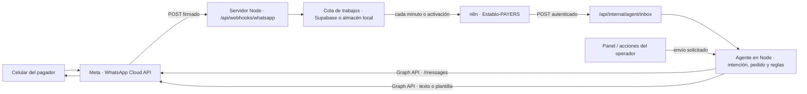

# Integración de WhatsApp Cloud API

> Guía de la integración de demostración de PAYERS. Los identificadores y credenciales se representan con marcadores; no pegues secretos en este documento.

## Tabla de contenido

1. [Resumen](#1-resumen)
2. [Arquitectura](#2-arquitectura)
3. [Variables de entorno](#3-variables-de-entorno)
4. [Flujo del webhook](#4-flujo-del-webhook)
5. [Rol de n8n](#5-rol-de-n8n)
6. [Comandos e intenciones](#6-comandos-e-intenciones)
7. [Reglas de mensajería](#7-reglas-de-mensajería)
8. [Seguridad](#8-seguridad)
9. [Configuración de la demo](#9-configuración-de-la-demo)
10. [Suscripción crítica de la WABA](#10-suscripción-crítica-de-la-waba)
11. [Solución de problemas](#11-solución-de-problemas)
12. [Operación diaria](#12-operación-diaria)
13. [Limitaciones conocidas](#13-limitaciones-conocidas)

## 1. Resumen

La aplicación recibe eventos de WhatsApp Cloud API en el servidor Node, guarda los mensajes elegibles en una bandeja de entrada y ejecuta el agente para responder por WhatsApp. En el modo documentado para esta demo, n8n despierta el procesamiento de la bandeja y evalúa alertas; la lógica del agente y las llamadas a Meta siguen en el servidor.

| Pieza | Papel |
|---|---|
| Meta / WhatsApp Cloud API | Entrega los mensajes y estados al webhook y recibe los mensajes salientes. |
| Servidor Node | Verifica el webhook, filtra y encola eventos, procesa mensajes, aplica reglas del pedido y envía respuestas. (`server/api.mjs`: `route`, `incoming`, `processInbox`; `server/providers.mjs`: `sendWhatsApp`.) |
| n8n | Dispara el procesamiento cada minuto o por webhook y solicita las rutas internas del servidor. No implementa por sí mismo la lógica conversacional. (`n8n/Establo-PAYERS.json`; `server/api.mjs`: `drainInbox`, `processInbox`.) |
| Supabase | Persiste pedidos, trabajos de la cola y configuración cuando se proporcionan las credenciales de servidor. Si no se configura Supabase, el servidor puede usar almacenamiento PostgreSQL local. (`README.md`; `server/config.mjs`: `readConfig`.) |
| Túnel HTTPS | Expone temporalmente el servidor local para que Meta y n8n puedan alcanzarlo. La guía usa Cloudflare Tunnel; la dirección temporal puede cambiar. (`n8n/Activacion.md`.) |

## 2. Arquitectura

El agente procesa y responde dentro del servidor. n8n es el disparador/orquestador externo; no recibe el contenido del mensaje como resultado del nodo de procesamiento, que devuelve conteos (`n8n/Establo-PAYERS.json`, nodo **Procesar mensajes y adjuntos**).



La cola está en Supabase cuando el almacén remoto está configurado; el backend local es una alternativa de desarrollo, no una dependencia de n8n. (`server/store.mjs`: `openStore`; `server/api.mjs`: manejador de `/api/webhooks/whatsapp`.)

## 3. Variables de entorno

La obligatoriedad de las variables se determina en `server/config.mjs`, función `readConfig`; los nombres y comentarios también aparecen en `.env.example`. “Obligatoria” se refiere al modo WhatsApp Cloud y a la configuración indicada, no a una instalación local con WhatsApp desactivado.

| Nombre | Obligatoria u opcional | Para qué sirve | Dónde se obtiene / define |
|---|---|---|---|
| `WHATSAPP_MODE` | Opcional para arrancar; debe ser `cloud` para habilitar esta integración. | Activa o desactiva el canal. | Se define en el entorno del servidor. |
| `WA_GRAPH_VERSION` | Obligatoria con `WHATSAPP_MODE=cloud`. | Versión de Graph API usada para enviar y descargar medios. | Panel/desarrolladores de Meta; versión exacta disponible para cada cuenta: **no verificado**. |
| `WA_PHONE_NUMBER_ID` | Obligatoria con `WHATSAPP_MODE=cloud`. | Identifica el número de WhatsApp en llamadas de Graph y filtra eventos entrantes. | Configuración/API de WhatsApp de la app en Meta. No copiar el ID a este documento. |
| `WA_ACCESS_TOKEN` | Obligatoria con `WHATSAPP_MODE=cloud`. | Autoriza llamadas de servidor para mensajes y medios. | Credenciales de la app de Meta; el token temporal de la demo vence. |
| `WA_VERIFY_TOKEN` | Obligatoria con `WHATSAPP_MODE=cloud`. | Secreto elegido por el operador, compartido entre el servidor y la configuración del callback para la verificación GET. | Lo genera el operador; no es un token que se lea de Meta. |
| `WA_APP_SECRET` | Obligatoria con `WHATSAPP_MODE=cloud`. | Se usa para verificar la firma HMAC de los POST de Meta. | Configuración de la app de Meta (secreto de la app). |
| `WA_ALLOWED_PHONES` | Obligatoria con `WHATSAPP_MODE=cloud`. | Lista separada por comas de remitentes autorizados para la demo, en dígitos y con código de país. | La define el operador; los destinatarios de prueba también se habilitan en Meta. Usa valores ficticios al documentar, por ejemplo `51XXXXXXXXX`. |
| `WA_TEMPLATE_DEPOSIT` | Opcional. | Nombre de la plantilla aprobada para iniciar un mensaje de anticipo. | Nombre de la plantilla aprobada en WhatsApp Manager. |
| `WA_TEMPLATE_VISIT` | Opcional. | Nombre de la plantilla aprobada para recordatorio de visita. | Nombre de la plantilla aprobada en WhatsApp Manager. |
| `WA_TEMPLATE_CONFIRMATION` | Opcional. | Nombre de la plantilla aprobada para confirmación del anticipo. | Nombre de la plantilla aprobada en WhatsApp Manager. |
| `WA_TEMPLATE_SETTLEMENT` | Opcional. | Nombre de la plantilla de liquidación/constancia final. | Nombre de la plantilla aprobada en WhatsApp Manager. |
| `WA_TEMPLATE_LANGUAGE` | Opcional. | Código de idioma que se envía al pedir una plantilla; el código predeterminado está en `.env.example`. | Debe corresponder al idioma aprobado para la plantilla en WhatsApp Manager. |
| `PUBLIC_URL` | Obligatoria si WhatsApp Cloud está activo. | Origen HTTPS público del servidor, sin ruta; se usa para enlaces y para que el servidor escuche públicamente. | URL del alojamiento o del túnel actual. |
| `AGENT_ORCHESTRATION` | Opcional; predeterminado `server`. | El modo `n8n` delega a n8n el disparo de bandeja y alertas. | Se define en el entorno del servidor. |
| `N8N_AGENT_TOKEN` | Obligatoria si `AGENT_ORCHESTRATION=n8n`. | Autentica las llamadas de n8n a las rutas internas; el servidor exige al menos 32 caracteres. | Se genera como secreto aleatorio y se configura en el servidor y la credencial Header Auth de n8n. |
| `N8N_WAKE_URL` | Opcional; si se configura debe ser HTTPS. | URL Production del webhook de n8n que puede despertar el workflow cuando entra una cola nueva. | Nodo **Despertar por WhatsApp** de n8n. |

Los nombres `WA_TEMPLATE_*` deben corresponder a plantillas aprobadas y a los parámetros que construye el servidor. Tener configurado un nombre no demuestra que Meta haya aprobado esa plantilla; la aprobación debe verificarse en Meta.

## 4. Flujo del webhook

1. **Verificación GET.** Meta llama `GET /api/webhooks/whatsapp` con `hub.mode`, `hub.verify_token` y `hub.challenge`. El servidor exige `hub.mode=subscribe` y compara el token recibido con `WA_VERIFY_TOKEN`; si coincide, devuelve el challenge como texto. (`server/api.mjs`: `route`, rama GET de `/api/webhooks/whatsapp`.)
2. **Recepción POST y firma.** El servidor lee el cuerpo sin alterar y valida `x-hub-signature-256` contra el HMAC-SHA256 del cuerpo calculado con `WA_APP_SECRET`. Si la firma no coincide, devuelve 403. (`server/api.mjs`: `route`; `server/providers.mjs`: `hmac`, `matches`.)
3. **Filtro de número de empresa.** Solo procesa los cambios cuyo `metadata.phone_number_id` coincide exactamente con `WA_PHONE_NUMBER_ID`. (`server/api.mjs`: `route`, rama POST del webhook.)
4. **Filtro de remitentes y enqueue.** Solo se encolan mensajes cuyo `from` coincide exactamente con un elemento de `WA_ALLOWED_PHONES` y tienen `id`. La configuración de la lista elimina caracteres no numéricos al cargarla; el `from` recibido no se normaliza en este filtro. (`server/config.mjs`: `readConfig`; `server/api.mjs`: `route`.)
5. **Procesamiento del trabajo.** En `incoming`, el agente descarta silenciosamente mensajes sin ID, con teléfono no permitido, timestamp no numérico, más antiguo de 24 horas o más de 60 segundos en el futuro. Luego busca pedidos de ese teléfono con `consent` y descarta si no hay ninguno o el ID ya existe en el chat. (`server/api.mjs`: `incoming`.)
6. **Referencia `EST-XXXXXXXX`.** Si el texto contiene una referencia con ese formato, el agente selecciona los pedidos cuyo código coincide. Si no hay candidatos, no continúa ni responde. Sin referencia, elige pedidos activos del teléfono (o, si no hay, los pedidos restantes); si hay varios candidatos, pide que se especifique la referencia. (`server/api.mjs`: `incoming`.)
7. **Cola y n8n.** El POST válido se guarda en el almacén. En modo `n8n`, el workflow llama `POST /api/internal/agent/inbox`; el servidor exige `Authorization: Bearer <N8N_AGENT_TOKEN>`, procesa hasta dos trabajos por ejecución y devuelve contadores `processed` y `failed`. (`server/api.mjs`: `route`, `processInbox`, `drainInbox`; `server/store.mjs`: `openStore`.)

Los eventos de estado (`sent`, `delivered`, `read`, `failed`) también se encolan y actualizan el estado del mensaje asociado. Una cola vacía puede producir `processed: 0, failed: 0`; es un resultado, no necesariamente un error. (`server/api.mjs`: manejador POST, `delivery`, `processInbox`.)

## 5. Rol de n8n

El workflow importable es **El Establo PAYERS · WhatsApp y alertas** (`n8n/Establo-PAYERS.json`).

- **Cada minuto** ejecuta el workflow programado. **Ejecutar prueba manual** también permite probarlo.
- **Despertar por WhatsApp** es un webhook POST de n8n con autenticación Header Auth. Si `N8N_WAKE_URL` está configurado, el servidor intenta llamar esa URL cuando encola trabajos; el workflow vuelve a consultar la API.
- **API del restaurante** contiene la URL de origen del servidor; hay que reemplazar el marcador del JSON importado.
- **Procesar mensajes y adjuntos** llama a `POST /api/internal/agent/inbox`.
- **Solo horario o prueba manual** deja pasar al nodo de alertas solo el disparador programado o la prueba manual. **Evaluar alertas configuradas** llama a `POST /api/internal/agent/alerts`.

Configura una credencial **Header Auth** con encabezado `Authorization` y valor `Bearer <N8N_AGENT_TOKEN>`. Selecciónala en los nodos que llaman al servidor y en **Despertar por WhatsApp**. La ruta interna valida ese bearer y exige `AGENT_ORCHESTRATION=n8n`. (`n8n/Activacion.md`; `server/api.mjs`: `route`, rutas `/api/internal/agent/*`.)

El workflow incluido no está activo al importarse (`active: false` en el JSON): publícalo/actívalo en n8n para el horario. La URL Production del nodo de despertar es opcional; si no se configura, la revisión por minuto sigue siendo el mecanismo periódico. (`n8n/Establo-PAYERS.json`; `n8n/Activacion.md`.)

## 6. Comandos e intenciones

El clasificador local de `server/intents.mjs` incluye atajos y ejemplos en español. Si se configura `OPENAI_API_KEY`, `server/agent-ai.mjs`, función `classify`, puede clasificar mensajes más largos; ante un error de esa clasificación vuelve al clasificador local. Las respuestas y acciones concretas están en `server/api.mjs`, función `replyTo`.

| Intención / ejemplos | Comportamiento |
|---|---|
| **Anticipo**, **enlace**, “quiero pagar” | Si el pedido sigue pendiente y no venció, crea o reutiliza el intento y responde con el enlace de demostración. Si ya no está pendiente, informa el resumen; si venció, indica que el personal puede revisar. |
| **Yape**, **Plin** | Si se escriben solos, se interpretan como solicitud de enlace para ese método de demostración. Los métodos pueden desactivarse en la configuración del agente. No representan una transferencia real. |
| **Saldo** | Responde el resumen del pedido, su estado, fecha de visita y saldo pendiente. |
| **Ya pagué**, “te envié el comprobante” | Registra un aviso/incidencia para revisión; no marca automáticamente el pago como confirmado. La confirmación depende del flujo de pago verificado. |
| **Reprogramar**, **cancelar**, **devolución**, **error de pago**, **ayuda** o pedir una persona | Registra una incidencia y responde que el personal revisará el caso. No realiza por chat la cancelación, devolución ni reprogramación. |
| **Constancia**, **comprobante** | Devuelve el enlace de la última constancia emitida; si aún no existe, indica que se habilitará al verificar el pago. |
| **Visita**, **asistencia** | Devuelve el resumen. Una afirmación de asistencia puede registrar una intención, pero la llegada se registra en recepción. |
| Otra consulta | Responde con el resumen y sugiere comandos como anticipo, saldo, reprogramar o ayuda. |

Las reglas de `classify` son intencionalmente limitadas; no se garantiza que cualquier paráfrasis se clasifique como se espera.

### Imágenes, notas de voz y documentos

- Para imagen y audio, el servidor descarga primero el medio de Meta. `OPENAI_API_KEY` es necesario para interpretarlos; la descarga también necesita la configuración de WhatsApp. (`server/api.mjs`: `incoming`; `server/agent-ai.mjs`: `readMedia`; `server/providers.mjs`: `downloadMedia`.)
- Las notas de voz se envían a transcripción y el texto obtenido se pasa al agente.
- Las imágenes admitidas se inspeccionan como posible comprobante. Se extraen datos visibles, pero la imagen no confirma el pago: se crea una incidencia de revisión. (`server/agent-ai.mjs`: `readMedia`; `server/api.mjs`: `replyTo`.)
- Los documentos no se procesan con IA y se derivan a revisión del personal (`server/api.mjs`: `incoming`).
- Sin `OPENAI_API_KEY`, el texto puede usar el clasificador local, pero no se pueden leer imágenes ni transcribir audios.

## 7. Reglas de mensajería

`server/providers.mjs`, función `sendWhatsApp`, permite texto libre cuando el pedido tiene un mensaje entrante en su chat dentro de las últimas 24 horas. Fuera de esa ventana exige la plantilla correspondiente; si no hay nombre configurado para la plantilla, la operación falla con 409. También exige consentimiento y teléfono permitido.

| Plantilla | Variables de cuerpo, en orden | Botón dinámico |
|---|---|---|
| Anticipo (`WA_TEMPLATE_DEPOSIT`) | Pagador, referencia, importe del anticipo | Índice 0: URL de pago con el identificador de intento. |
| Visita (`WA_TEMPLATE_VISIT`) | Pagador, referencia, fecha/hora de visita, saldo | Ninguno. |
| Confirmación (`WA_TEMPLATE_CONFIRMATION`) | Pagador, referencia, fecha/hora de visita, saldo | Ninguno. |
| Liquidación (`WA_TEMPLATE_SETTLEMENT`) | Pagador, referencia, importe total | Índice 0: URL de constancia con el token de la constancia. |

El idioma se toma de `WA_TEMPLATE_LANGUAGE` (predeterminado documentado en `.env.example`). Los nombres de plantilla deben ser los aprobados en Meta y su estructura/idioma deben coincidir con las variables anteriores.

**Caso particular:** al enviar una constancia de anticipo desde el botón de comprobante, el servidor no asigna `WA_TEMPLATE_SETTLEMENT` (esa plantilla se asigna a la liquidación). Por lo tanto, sin ventana de 24 horas, ese envío no tiene una plantilla configurada en el código y puede devolver 409. (`server/api.mjs`: rama `receipt` de la acción `message`; `server/providers.mjs`: `sendWhatsApp`.)

## 8. Seguridad

- La firma de cada POST se valida en el servidor con `WA_APP_SECRET`; no desactives esa validación. (`server/api.mjs`: `route`; `server/providers.mjs`: `hmac`, `matches`.)
- `WA_ALLOWED_PHONES` restringe los remitentes de la demo. Un pedido solo se usa si su teléfono coincide y tiene `consent=true`. (`server/api.mjs`: `incoming`; `server/config.mjs`: `readConfig`.)
- Meta necesita una dirección pública para entregar webhooks, pero los secretos permanecen del lado servidor. No pongas tokens, claves, `WA_APP_SECRET`, `WA_VERIFY_TOKEN`, `N8N_AGENT_TOKEN` ni la clave de Supabase en JavaScript del navegador, en el workflow exportado ni en el repositorio.
- El servidor necesita `WA_ACCESS_TOKEN` para llamar Graph; n8n recibe únicamente la credencial interna para invocar las rutas de agente. (`server/providers.mjs`: `sendWhatsApp`, `downloadMedia`; `server/api.mjs`: autenticación de rutas internas.)
- Usa credenciales distintas por entorno y rota cualquier secreto que se haya compartido accidentalmente. Los tokens de demostración no deben tratarse como credenciales de producción.

## 9. Configuración de la demo

1. **Meta y WhatsApp.** Crea una app de Meta para la demo, agrega el producto/caso de uso de WhatsApp y selecciona el número de prueba disponible. La navegación exacta de Meta puede variar (**no verificado**). Añade el celular de prueba como destinatario permitido en la configuración de Meta.
2. **Credenciales.** Obtén el `WA_PHONE_NUMBER_ID`, un token temporal de acceso y el App Secret. Genera un valor propio para `WA_VERIFY_TOKEN`. Configura esos valores solo en `.env` del servidor.
3. **Lista y consentimiento.** Configura `WHATSAPP_MODE=cloud` y `WA_ALLOWED_PHONES` con el teléfono de prueba, con código de país y solo dígitos. En el panel registra un pedido con ese teléfono y permiso de contacto. (La lista y el consentimiento se verifican en `server/api.mjs`: `incoming`.)
4. **Túnel.** Desde una ventana de terminal ejecuta el túnel hacia el puerto de Node:

   ```powershell
   cloudflared tunnel --url http://127.0.0.1:5173
   ```

   Mantén la ventana abierta y copia el origen HTTPS asignado. Configúralo en `PUBLIC_URL` sin una ruta.
5. **Servidor.** Si aún no hay dependencias, instala según README; después construye y arranca el servidor:

   ```powershell
   npm.cmd ci
   npm.cmd run build
   npm.cmd start
   ```

   Si editaste `.env`, reinicia el proceso Node para que vuelva a cargarlo.
6. **Webhook de Meta.** En la configuración de WhatsApp de la app registra como URL de devolución `https://<TU_DOMINIO>/api/webhooks/whatsapp` y el mismo valor configurado en `WA_VERIFY_TOKEN`. Suscribe el campo `messages`. La ruta de menús “Casos de uso → Personalizar → Configuración” es una referencia de interfaz y puede cambiar (**no verificado**).
7. **WABA.** Asegúrate de que la app correcta esté suscrita a la cuenta de WhatsApp Business (WABA); consulta el [paso crítico](#10-suscripción-crítica-de-la-waba).
8. **n8n.** Importa `n8n/Establo-PAYERS.json`; en **API del restaurante** reemplaza el marcador por el origen HTTPS. Configura la credencial Header Auth para enviar el encabezado `Authorization` con `Bearer`, un espacio y el token interno que configuraste. Asígnala a los nodos correspondientes, configura `AGENT_ORCHESTRATION=n8n` y el mismo token en `.env`, y activa/publica el workflow.
9. **Prueba.** Envía `anticipo EST-XXXXXXXX` desde el número autorizado, usando la referencia real del pedido de prueba. Confirma la recepción en el panel y la actividad de n8n. No uses datos de clientes reales para la demo.

Para analizar imágenes y audios, configura también `OPENAI_API_KEY` en el servidor. Es opcional para texto.

## 10. Suscripción crítica de la WABA

Suscribirse al campo `messages` en la configuración de webhook de la app y suscribir la app a la WABA son pasos distintos. El código del proyecto valida los eventos que recibe, pero no consulta ni administra las suscripciones de Meta.

**Incidencia reportada durante esta demo:** el botón **Probar** de Meta alcanzaba el servidor, pero los mensajes reales no llegaban porque, según el diagnóstico reportado, la WABA estaba suscrita a otra app interna de Meta. Este síntoma y su causa no se pueden comprobar en el código de este repositorio: **no verificado** por estos archivos.

Comprueba qué apps están suscritas y, si falta la app correcta, solicita la suscripción con Graph API. Sustituye todos los marcadores antes de ejecutar; no guardes el token en el historial del shell ni lo publiques.

```sh
curl -i \
  -H "Authorization: Bearer <TOKEN_DE_ACCESO_AUTORIZADO>" \
  "https://graph.facebook.com/<WA_GRAPH_VERSION>/<WABA_ID>/subscribed_apps"
```

```sh
curl -i -X POST \
  -H "Authorization: Bearer <TOKEN_DE_ACCESO_AUTORIZADO>" \
  "https://graph.facebook.com/<WA_GRAPH_VERSION>/<WABA_ID>/subscribed_apps"
```

El token debe estar autorizado para administrar esa WABA y suscribir la app; el tipo exacto de token y los permisos requeridos dependen de la configuración de Meta y **no están verificados por el código del proyecto**. Comprueba en la respuesta GET que aparece la app de esta integración y vuelve a probar un mensaje real. No publiques la respuesta si contiene IDs de cuentas o apps.

## 11. Solución de problemas

| Síntoma | Causa posible | Solución |
|---|---|---|
| El agente no responde y el panel no registra el mensaje. | La app no está suscrita a la WABA correcta; el token de acceso venció; o el túnel expone otra dirección. La causa exacta no se deduce solo del código (**no verificado** para una ejecución concreta). | Comprueba `subscribed_apps` en la WABA, renueva el token si corresponde, confirma que `PUBLIC_URL`/callback apuntan al túnel activo y revisa el POST del webhook. |
| Meta dice “No se pudo validar la URL de devolución de llamada o el token de verificación”. | Túnel cerrado, `WA_VERIFY_TOKEN` distinto, servidor no reiniciado tras cambiar `.env`, o `PUBLIC_URL` desactualizada. | Mantén el túnel abierto, reinicia Node, confirma el mismo token en Meta y en el servidor, y verifica que la URL use `/api/webhooks/whatsapp`. La ruta GET devuelve `hub.challenge` solo si el modo y token coinciden (`server/api.mjs`: `route`). |
| “Enviar último” devuelve 409. | No hay un mensaje entrante dentro de las últimas 24 horas o no hay una plantilla aplicable/aprobada. Para la constancia de anticipo, el código no asigna plantilla de liquidación. | Pide al pagador que abra la ventana escribiendo al número, o usa una plantilla aprobada que el código admita. Revisa el caso particular de constancia en [Reglas de mensajería](#7-reglas-de-mensajería). |
| Error 190 / “Session has expired”. | Token temporal de acceso vencido (**mensaje y causa no verificados por el código**). | Renueva el token desde Meta, actualiza `WA_ACCESS_TOKEN` en el entorno del servidor y reinicia Node. |
| Error (#200) “Provide valid app ID”. | La petición pudo salir sin un token válido (**causa exacta no verificada**). | Confirma que `WA_ACCESS_TOKEN` esté definido y que el servidor haya reiniciado. `sendWhatsApp` y `downloadMedia` adjuntan un bearer token (`server/providers.mjs`). |
| El agente ignora el mensaje. | El remitente no está exactamente en `WA_ALLOWED_PHONES`, el pedido no tiene `consent`, el teléfono del pedido no coincide, el timestamp queda fuera del rango o la referencia no selecciona ningún pedido. | Compara los dígitos del `from`, la lista y el teléfono del pedido; confirma consentimiento y envía una referencia `EST-XXXXXXXX` válida. Revisa `incoming` en `server/api.mjs`. |
| n8n devuelve `processed: 0, failed: 0`. | No había trabajos pendientes en la cola cuando se ejecutó el workflow. | Genera un evento entrante elegible y vuelve a ejecutar. El resultado cero por sí solo no indica fallo (`server/api.mjs`: `processInbox`; `n8n/Activacion.md`). |

También comprueba que `metadata.phone_number_id` coincida con `WA_PHONE_NUMBER_ID`, que la firma sea válida y que `AGENT_ORCHESTRATION=n8n` y `N8N_AGENT_TOKEN` estén configurados para la ruta interna.

## 12. Operación diaria

- **Token temporal:** renueva el token desde Meta antes de que venza, actualiza `WA_ACCESS_TOKEN` solo en el entorno del servidor y reinicia Node. No lo incluyas en el workflow ni en tickets.
- **Cambio de túnel:** cuando la dirección temporal cambie, actualiza `PUBLIC_URL`, el origen en el nodo **API del restaurante** de n8n y la URL callback en Meta; reinicia Node y vuelve a validar el webhook. Mantén el túnel y el servidor activos. (`n8n/Activacion.md`.)
- **Rotación de `N8N_AGENT_TOKEN`:** genera un token nuevo de al menos 32 caracteres, actualízalo en `.env` y en la credencial Header Auth de n8n; reinicia Node y prueba el workflow. Durante el cambio, las llamadas con el token anterior dejarán de autenticarse.
- **Rotación de Supabase:** crea/rota la credencial de servidor desde Supabase, actualiza `SUPABASE_SECRET_KEY` solo en el entorno del servidor y reinicia Node. El proyecto requiere URL y clave de servidor para el almacén remoto (`server/config.mjs`: `readConfig`; `README.md`). No la copies a n8n ni al navegador.
- **Workflow:** confirma que esté activo y que use el origen HTTPS correcto. La URL de despertar puede reducir la espera, pero el workflow programado cada minuto es el disparador periódico.

## 13. Limitaciones conocidas

- La guía está orientada al número de prueba de Meta y sus destinatarios de prueba; el envío a números fuera de esa configuración no está garantizado.
- El token temporal caduca y requiere renovación.
- Sin plantillas aprobadas/configuradas no se pueden iniciar mensajes libres fuera de la ventana permitida.
- El túnel temporal no garantiza una dirección fija ni disponibilidad continua.
- La guía no cubre el alta de un número real, la verificación del negocio ni la publicación/revisión de la app para producción.
- Las respuestas de pago son de demostración y las imágenes de comprobante no verifican ni confirman un pago.
- La suscripción de la WABA y las pantallas actuales de Meta son configuración externa; su estado no se puede verificar desde este repositorio.

### Elementos marcados como “no verificado”

- Sección 3: versión de Graph API disponible para una cuenta concreta.
- Sección 9: navegación actual de la interfaz de Meta.
- Sección 10: causa reportada de la incidencia de suscripción WABA y tipo/permisos exactos del token Graph requerido.
- Sección 11: causa de errores específicos 190 y (#200) para una ejecución particular.
